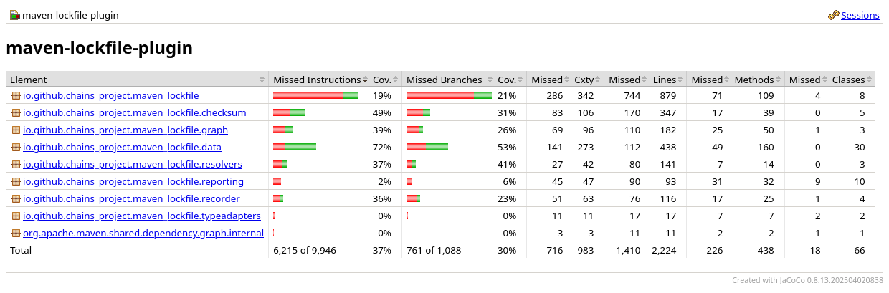
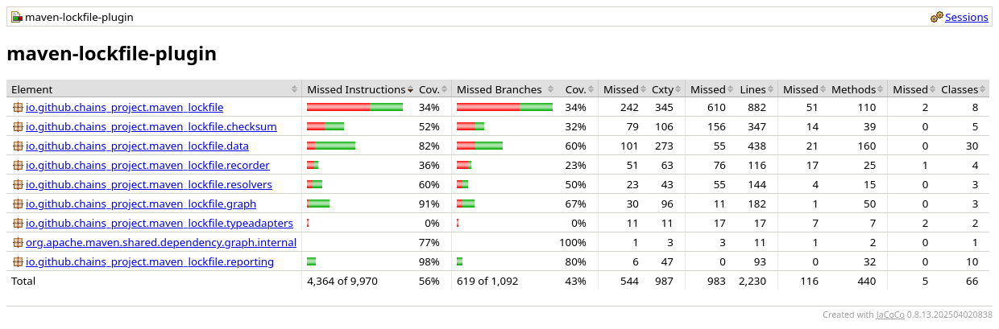
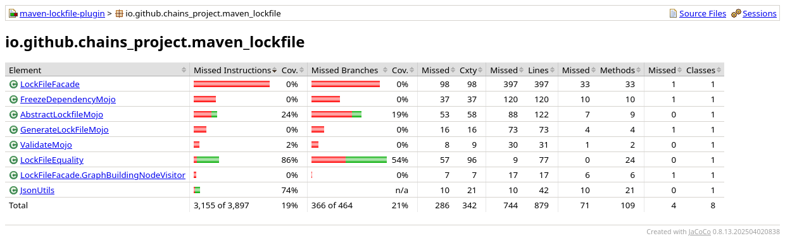
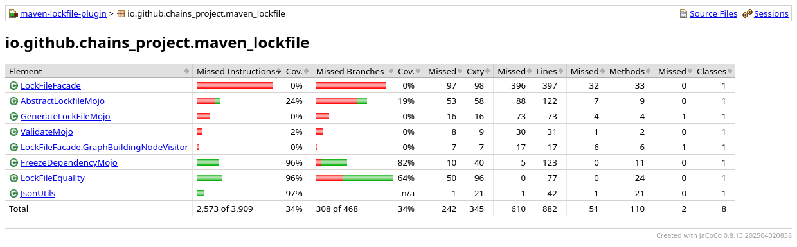
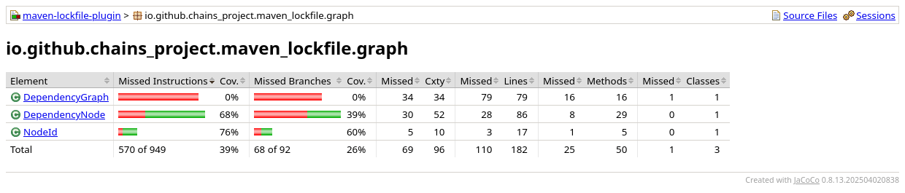
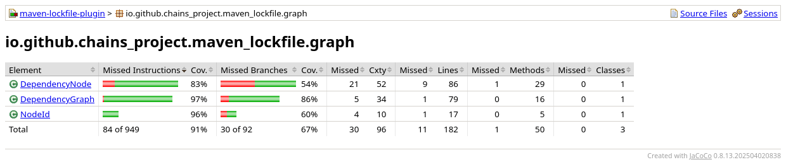
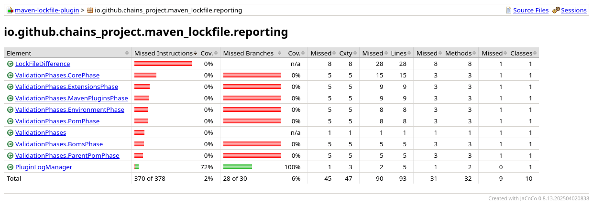
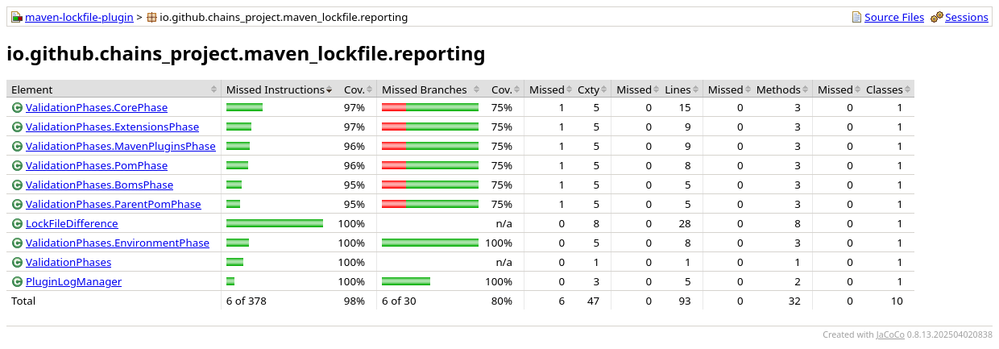

# Testy – maven-lockfile

Projekt: [chains-project/maven-lockfile](https://github.com/chains-project/maven-lockfile), Maven plugin (Java 11),
ktorý generuje a overuje `lockfile.json` s checksumami všetkých závislostí a pluginov.
Testy sú na branchi `ess/tests-coverage-profiling`, ktorá vychádza z `main` (commit `d612dce`).

Nástroje: JUnit 5, AssertJ, Mockito (už boli v projekte), JaCoCo 0.8.13 na meranie pokrytia.
Prostredie: Linux 6.8, OpenJDK 23, Maven 3.9.6 (wrapper `./mvnw`).

---

## 1. Implementované testy

### 1.1 Súhrn

| | |
|---|---|
| Nové testovacie metódy | **46** v 8 nových testovacích triedach |
| Úspešné | **46 / 46** (celá sada unit testov projektu: 120 / 120) |
| Odhalili chybu | **1** (`FreezeDependencyMojoTest.classifierVariantsOfTheSameArtifactAreAllManaged`) |
| Pomocné triedy (nie sú to testy) | `FakeChecksumCalculator`, `DependencyNodes`, `VerboseDependencyNodes` |

Počet unit testov v projekte stúpol zo **74 na 120**.

### 1.2 Prehľad testovacích tried

| Testovacia trieda | Testovaný modul | Testy | Úspešné | Čo overuje |
|---|---|---|---|---|
| `DependencyGraphTest` | `graph.DependencyGraph` | 9 | 9 | prevod Maven stromu závislostí na model lockfilu: odstránenie koreňa projektu, vzťah rodič/potomok, checksumy a scope, `prewarmArtifactCache` volaný raz s unikátnymi artefaktmi, prázdny checksum pre reactor SNAPSHOT, konflikt verzií v režime *reduced* aj *non-reduced*, deduplikácia, prázdny graf, `equals`/`hashCode` |
| `ValidationPhasesTest` | `reporting.ValidationPhases` (7 fáz) | 12 | 12 | `isEnabled`, `validate`, `isWarn` každej fázy, poradie fáz, obsah chybových hlásení, predvolene vypnuté voliteľné fázy |
| `LockFileDifferenceTest` | `reporting.LockFileDifference` | 4 | 4 | rozdiel dvoch lockfilov (chýbajúce závislosti, pluginy, extensions na oboch stranách), zmenený checksum, defenzívne kópie |
| `FreezeDependencyMojoTest` | `FreezeDependencyMojo` (goal `freeze`) | 7 | 7 | pripnutie priamych závislostí, tranzitívne závislosti v `dependencyManagement`, `exactVersionStrings`, verzia, ktorá už je rozsah, pluginy a ich runtime závislosti, chýbajúci lockfile, **varianty s classifierom** |
| `ProjectBuilderTest` | `resolvers.ProjectBuilder` | 4 | 4 | aký `ProjectBuildingRequest` sa posiela do Mavenu, použitie POM z lokálneho repozitára bez sťahovania, projekt, ktorý sa nedá postaviť |
| `ConfigTest` | `data.Config` | 4 | 4 | predvolená konfigurácia, mapovanie všetkých enumov, JSON round-trip |
| `PomChecksumTest` | `checksum.AbstractChecksumCalculator` (`calculatePomChecksum`) | 3 | 3 | testovací vektor SHA-256 z FIPS 180-2, normalizácia koncov riadkov (CRLF/CR/LF), chýbajúci súbor |
| `SpyingDependencyNodeUtilsTest` | `SpyingDependencyNodeUtils` (balík `org.apache.maven.shared.dependency.graph.internal`) | 3 | 3 | reflexívne čítanie víťaznej verzie z Maven `ConflictData` |
| **Spolu** | | **46** | **46** | |

Testy pokrývajú časti projektu, ktoré predtým nemali žiadne alebo len minimálne testy: `DependencyGraph`, všetky
validačné fázy, `LockFileDifference` a `FreezeDependencyMojo` mali 0 % pokrytie.

### 1.3 Test, ktorý odhalil chybu

**Test:** `FreezeDependencyMojoTest.classifierVariantsOfTheSameArtifactAreAllManaged`

**Chyba:** goal `freeze` vytvára z lockfilu `pom.lockfile.xml` s pripnutými verziami všetkých závislostí. Závislosti
pri tom identifikoval iba podľa `groupId:artifactId`. Ak lockfile obsahuje viac variantov toho istého artefaktu
s rôznym **classifierom**, do výsledného POM sa dostal iba jeden z nich. Typický príklad sú natívne knižnice pre rôzne
platformy, napr. `netty-transport-native-epoll` s classifiermi `linux-x86_64` a `linux-aarch_64`. Ostatné varianty
zostali nepripnuté, čo je v rozpore s účelom goalu.

**Výstup testu na pôvodnom kóde:**

```
FreezeDependencyMojoTest.classifierVariantsOfTheSameArtifactAreAllManaged <<< FAILURE!
Expecting actual:
  ["linux-x86_64"]
to contain exactly in any order:
  ["linux-x86_64", "linux-aarch_64"]
but could not find the following elements:
  ["linux-aarch_64"]
```

**Oprava:** v `FreezeDependencyMojo` som pridal metódu `dependencyKey`. Kľúč je `groupId:artifactId` a ak má
závislosť classifier, pridá sa k nemu `:classifier`. Pre závislosti bez classifiera sa správanie nemení.

```java
private static String dependencyKey(Dependency dep) {
    String key = dep.getGroupId() + ":" + dep.getArtifactId();
    String classifier = dep.getClassifier();
    return classifier == null || classifier.isEmpty() ? key : key + ":" + classifier;
}
```

**Overenie:** nové testy som spustil proti pôvodnému produkčnému kódu (commit `d612dce`, bez opravy).
Zo 116 testov zlyhal presne tento jeden, ostatných 115 prešlo. Výstup je v `data/bugcheck-original-code.txt`.
`ProjectBuilderTest` v tomto behu nebol, lebo 3 zo 4 jeho testov používajú konštruktor, ktorý pribudol až pri
optimalizácii výkonu. Po oprave prechádza všetkých 120 unit testov aj 5 integračných testov goalu `freeze`.

---

## 2. Pokrytie kódu pred a po

### 2.1 Meranie

```bash
./mvnw org.jacoco:jacoco-maven-plugin:0.8.13:prepare-agent test \
       org.jacoco:jacoco-maven-plugin:0.8.13:report
# HTML report: target/site/jacoco/index.html, CSV: target/site/jacoco/jacoco.csv
```

- **Pred:** čistá kópia commitu `d612dce` (pôvodný kód a pôvodných 74 testov).
- **Po:** aktuálny stav branche (120 testov).

Meria sa pokrytie unit testami. Integračné testy spúšťajú Maven v samostatnom procese, takže ich JaCoCo agent
nezachytí. JaCoCo som nepridal do `pom.xml`, lebo projekt sám seba zamyká vlastným `lockfile.json`, ktorý obsahuje
checksum `pom.xml`. Každá zmena POM by vyžadovala pregenerovať lockfile.

### 2.2 Celkové pokrytie

| Metrika | Pred | Po | Zmena |
|---|---|---|---|
| Počet unit testov | 74 | **120** | +46 |
| Riadky | 36,6 % (815/2226) | **55,9 %** (1248/2232) | **+19,3 p. b.** |
| Vetvy | 30,1 % (327/1088) | **43,3 %** (473/1092) | +13,3 p. b. |
| Inštrukcie | 37,5 % (3731/9946) | **56,2 %** (5606/9970) | +18,7 p. b. |
| Metódy | 48,4 % (212/438) | **73,6 %** (324/440) | +25,2 p. b. |

Celkový počet riadkov sa mierne zvýšil (2226 → 2232), pretože pribudla oprava chyby (`dependencyKey`) a nový
konštruktor v `ProjectBuilder`.

### 2.3 Pokrytie riadkov po balíkoch

| Balík | Pred | Po | Zmena |
|---|---|---|---|
| `maven_lockfile.reporting` | 3/93 (3,2 %) | 93/93 (**100 %**) | +96,8 p. b. |
| `org.apache.maven.shared.dependency.graph.internal` | 0/11 (0 %) | 8/11 (72,7 %) | +72,7 p. b. |
| `maven_lockfile.graph` | 72/182 (39,6 %) | 171/182 (**94,0 %**) | +54,4 p. b. |
| `maven_lockfile.resolvers` | 61/141 (43,3 %) | 89/144 (61,8 %) | +18,5 p. b. |
| `maven_lockfile` | 135/879 (15,4 %) | 272/882 (30,8 %) | +15,5 p. b. |
| `maven_lockfile.data` | 326/438 (74,4 %) | 383/438 (87,4 %) | +13,0 p. b. |
| `maven_lockfile.checksum` | 177/347 (51,0 %) | 191/347 (55,0 %) | +4,0 p. b. |

### 2.4 Triedy s najväčším nárastom (riadky)

| Trieda | Pred | Po |
|---|---|---|
| `FreezeDependencyMojo` | 0 % | 95,9 % |
| `graph.DependencyGraph` | 0 % | 98,7 % |
| `reporting.LockFileDifference` | 0 % | 100 % |
| `reporting.ValidationPhases` (všetkých 7 fáz) | 0 % | 100 % |
| `data.Config` | 55,7 % | 100 % |
| `checksum.AbstractChecksumCalculator` | 22,2 % | 94,4 % |
| `resolvers.ProjectBuilder` | 9,4 % | 58,9 % |
| `LockFileEquality` | 88,3 % | 100 % |

Úplný rozdiel po triedach je v `data/coverage-diff.txt`.

### 2.5 Screenshoty z JaCoCo

Celý projekt **pred**:



Celý projekt **po**:



Detaily balíkov s najväčšou zmenou:

Balík `maven_lockfile` **pred** (`FreezeDependencyMojo` 0 %):



Balík `maven_lockfile` **po** (`FreezeDependencyMojo` 96 %):



Balík `maven_lockfile.graph` **pred** (`DependencyGraph` 0 %):



Balík `maven_lockfile.graph` **po**:



Balík `maven_lockfile.reporting` **pred** (validačné fázy a `LockFileDifference` 0 %):



Balík `maven_lockfile.reporting` **po**:



Kompletné HTML reporty, v ktorých sa dá klikať až na úroveň zdrojového kódu, sú v `data/jacoco-pred/index.html`
a `data/jacoco-po/index.html`.

---

## 3. Test doubles: fake, stub, mock

Použitá terminológia (G. Meszaros, M. Fowler):

- **Fake:** funkčná, ale zjednodušená implementácia skutočnej závislosti, napr. bez siete a bez súborov.
- **Stub:** vracia vopred pripravené odpovede. Test potom overuje výsledok alebo stav testovaného kódu.
- **Mock:** test na ňom overuje **interakciu**, teda či a s akými argumentmi ho testovaný kód zavolal.

### 3.1 Fake – `FakeChecksumCalculator`

**Kde:** `src/test/java/.../checksum/FakeChecksumCalculator.java`. Používa sa v `DependencyGraphTest`
(9 testov) a `PomChecksumTest` (3 testy).

**Ako:** ručne napísaná podtrieda abstraktnej triedy `AbstractChecksumCalculator`. Namiesto hashovania JAR súborov
z lokálneho repozitára alebo sťahovania z Maven Central vracia deterministický checksum odvodený zo súradníc artefaktu
a falošnú URL repozitára. Navyše si zaznamenáva volania: koľkokrát a s akými artefaktmi bol zavolaný
`prewarmArtifactCache` a pre ktoré artefakty sa pýtal checksum.

```java
@Override
public String calculateArtifactChecksum(Artifact artifact) {
    checksumRequests.add(artifact);
    return checksumFor(artifact.getGroupId(), artifact.getArtifactId(), artifact.getVersion());
}

@Override
public void prewarmArtifactCache(Collection<Artifact> artifacts) {
    prewarmCalls.add(new ArrayList<>(artifacts));
}
```

Príklad použitia v `DependencyGraphTest`:

```java
DependencyGraph.of(mavenGraph, calc, false, Set.of());

assertThat(calc.getPrewarmCalls()).hasSize(1);
assertThat(calc.getPrewarmCalls().get(0))
        .extracting(Artifact::getArtifactId)
        .containsExactlyInAnyOrder("a", "c", "shared");
```

**Prečo:**

- Skutočné implementácie potrebujú buď stiahnuté JAR súbory v `~/.m2` (`FileSystemChecksumCalculator`), alebo
  sieťový prístup na Maven Central (`RemoteChecksumCalculator`). Testy by boli pomalé, nedeterministické a bez
  internetu by padali. S fake sú hermetické a bežia v milisekundách.
- Predvídateľný checksum (`fake-org.a:a:1.0`) umožňuje presne overiť, že sa checksum z kalkulátora dostal do
  správneho uzla grafu.
- Fake je tu vhodnejší ako Mockito mock. Musí sa správať konzistentne pre ľubovoľný počet artefaktov a zároveň
  zachovať **skutočné** zdedené metódy abstraktnej triedy. `PomChecksumTest` testuje práve zdedenú metódu
  `calculatePomChecksum` (SHA-256 POM súboru s normalizáciou koncov riadkov). Fake slúži len na to, aby sa dala
  abstraktná trieda inštancovať.

### 3.2 Stub – `Config`, `MavenProject`, Maven session

**Kde a ako:**

| Test | Stub | Čo vracia |
|---|---|---|
| `ValidationPhasesTest` (11 z 12 testov) | `mock(Config.class)` + `when(...).thenReturn(...)` | iba tú jednu voľbu, ktorú testovaná fáza číta, napr. `isIncludeEnvironment()` alebo `getOnPomValidationFailure()` |
| `FreezeDependencyMojoTest` (všetkých 7) | `mock(MavenProject.class)` | `getBasedir()` → dočasný adresár (`@TempDir`), `getFile()` → cesta k `pom.xml` v ňom |
| `ProjectBuilderTest` (všetky 4) | `MavenSession`, `RepositorySystemSession`, `PlexusContainer`, `ProjectBuildingResult` | lokálny repozitár v dočasnom adresári, prázdny `ProjectBuildingRequest`, Maven `ProjectBuilder` z kontajnera, postavený `MavenProject` alebo `null` |

```java
Config config = mock(Config.class);
when(config.isIncludeEnvironment()).thenReturn(true);
assertThat(phase("EnvironmentPhase").isEnabled(config)).isTrue();

when(config.isIncludeEnvironment()).thenReturn(false);
assertThat(phase("EnvironmentPhase").isEnabled(config)).isFalse();
```

**Prečo:**

- `Config` má konštruktor so 17 parametrami, ale každá validačná fáza číta jednu alebo dve voľby. So stubom test
  uvádza iba to, na čom záleží, a je hneď vidieť, ktorá voľba fázu ovplyvňuje. Test
  `optionalPhasesAreDisabledByDefault` zámerne využíva to, že stub vracia pre neuvedené boolean metódy `false`.
- Skutočný `MavenProject` vzniká len počas Maven buildu (model building, Plexus kontajner). Goal `freeze` z neho
  potrebuje iba adresár projektu a cestu k `pom.xml`. Stub ich nasmeruje do dočasného adresára, kde test pripraví
  vlastný `pom.xml` a `lockfile.json`. Overuje sa potom **výsledný stav**, teda obsah vygenerovaného
  `pom.lockfile.xml`.
- `MavenSession` a `PlexusContainer` sa mimo bežiaceho Mavenu nedajú jednoducho vytvoriť.

### 3.3 Mock – Maven `Log`, Maven `ProjectBuilder`, `PlexusContainer`

**Kde a ako:**

**`FreezeDependencyMojoTest`:** `Log` (logger Maven pluginu) je `mock(Log.class)`. Testy
`versionThatIsAlreadyARangeIsKeptAndWarnedAbout` a `pluginsArePinnedAndMissingPluginsAreAddedWithTheirRuntimeDependencies`
overujú, ktoré varovania mojo vypísal a ktoré nie:

```java
verify(log).warn(contains("Plugin org.extra:extra-plugin not found in POM"));
verify(log, never()).warn(contains("maven-compiler-plugin"));
```

**`ProjectBuilderTest`:** Maven `ProjectBuilder` je mock. `ArgumentCaptor` zachytí `ProjectBuildingRequest` a súbor
POM, s ktorými ho trieda zavolala. Test potom overí ich obsah. Na `PlexusContainer` sa overuje, že sa vôbec nezavolal
`ArtifactResolver`:

```java
ArgumentCaptor<ProjectBuildingRequest> request = ArgumentCaptor.forClass(ProjectBuildingRequest.class);
verify(mavenProjectBuilder).build(any(File.class), request.capture());
assertThat(request.getValue().isResolveDependencies()).isFalse();

verify(container, never()).lookup(ArtifactResolver.class);
```

**Prečo:**

- Varovanie v logu je jediný pozorovateľný výstup niektorých vetiev goalu `freeze`. Ak plugin z lockfilu chýba
  v POM, výsledný súbor vyzerá rovnako, či používateľ varovanie dostal, alebo nie. Overiť to vie iba mock.
  `never()` zároveň kontroluje, že sa nevypisujú falošné varovania pre pluginy, ktoré v POM sú.
- Pri `ProjectBuilder` je testovaným správaním to, **aký request trieda pošle Mavenu**: či má zapnuté rozlišovanie
  závislostí (príznak z optimalizácie výkonu, ktorý ušetril ~18 % CPU času) a vypnuté spracovanie pluginov.
  Návratová hodnota to neukáže, preto treba zachytiť argument volania.
- `verify(container, never()).lookup(ArtifactResolver.class)` dokazuje, že POM, ktorý už je v lokálnom repozitári,
  sa použije priamo a nesťahuje sa znova.
- Skutočný Maven `ProjectBuilder` by vyžadoval celý Maven runtime a prístup k repozitárom.

### 3.4 Súhrn

| Druh | Objekt | Testovacie triedy | Počet testov |
|---|---|---|---|
| Fake | `FakeChecksumCalculator` (ručne napísaný) | `DependencyGraphTest`, `PomChecksumTest` | 12 |
| Stub | `Config`, `MavenProject`, `MavenSession`, `RepositorySystemSession`, `ProjectBuildingResult` (Mockito) | `ValidationPhasesTest`, `FreezeDependencyMojoTest`, `ProjectBuilderTest` | 22 |
| Mock | `Log`, Maven `ProjectBuilder`, `PlexusContainer` (Mockito `verify`, `never`, `ArgumentCaptor`) | `FreezeDependencyMojoTest`, `ProjectBuilderTest` | 5 |

Pomocné triedy `DependencyNodes` a `VerboseDependencyNodes` nie sú test doubles. Sú to buildery testovacích dát,
ktoré vytvárajú **skutočné** objekty (`DependencyNode`, Maven `VerboseDependencyNode`). `VerboseDependencyNodes`
je v balíku `org.apache.maven.shared.dependency.graph.internal`, aby mal prístup k package-private konštruktoru
Maven triedy.

---

## 4. Ako to zopakovať

```bash
# všetky unit testy + pokrytie
./mvnw org.jacoco:jacoco-maven-plugin:0.8.13:prepare-agent test org.jacoco:jacoco-maven-plugin:0.8.13:report
python3 ess/scripts/covdiff.py ess/data/coverage-before.csv target/site/jacoco/jacoco.csv

# iba nové testy
./mvnw test -Dtest='DependencyGraphTest,ValidationPhasesTest,LockFileDifferenceTest,FreezeDependencyMojoTest,ProjectBuilderTest,ConfigTest,PomChecksumTest,SpyingDependencyNodeUtilsTest'

# unit + integračné testy
./mvnw verify
```
